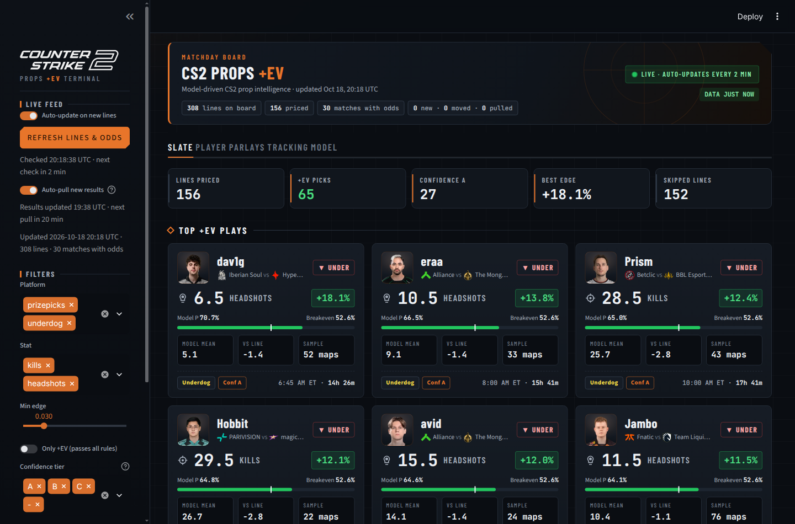
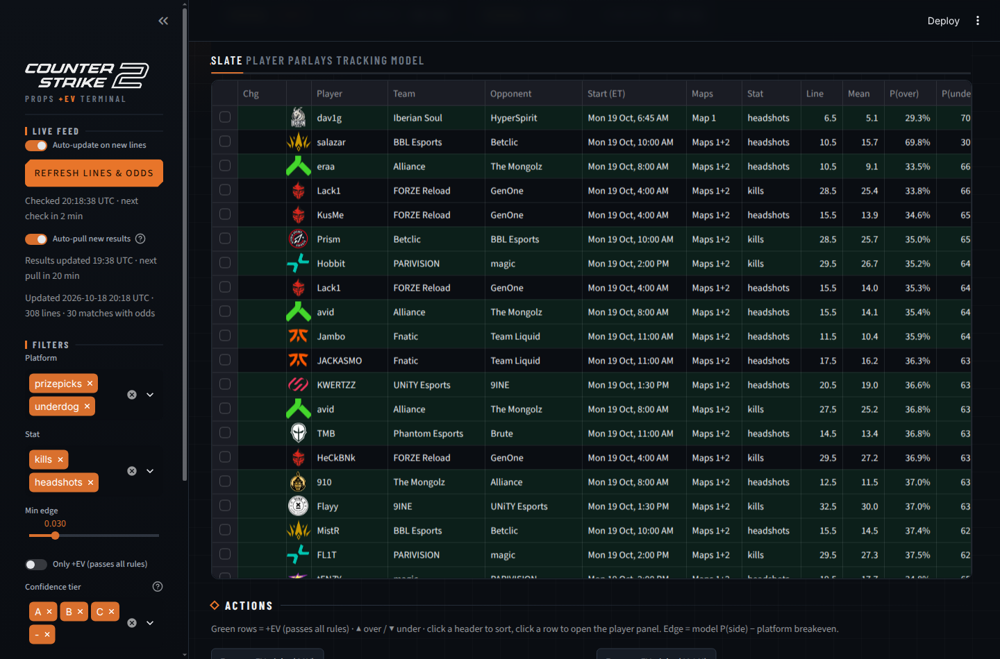
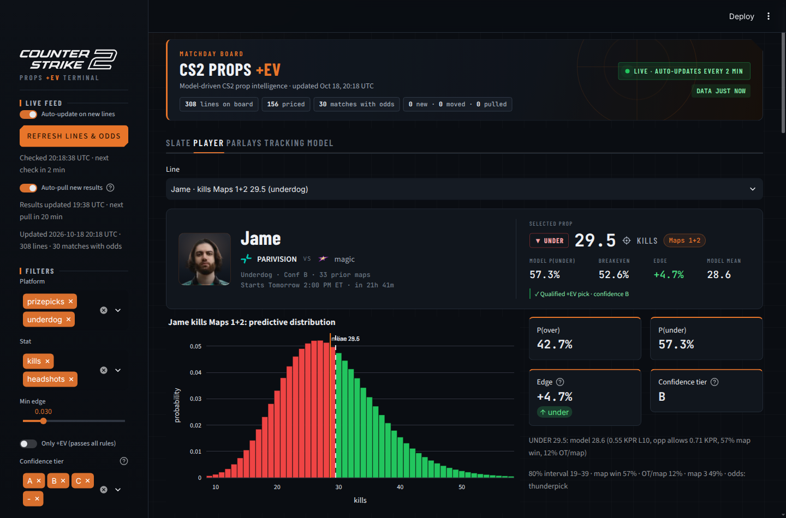
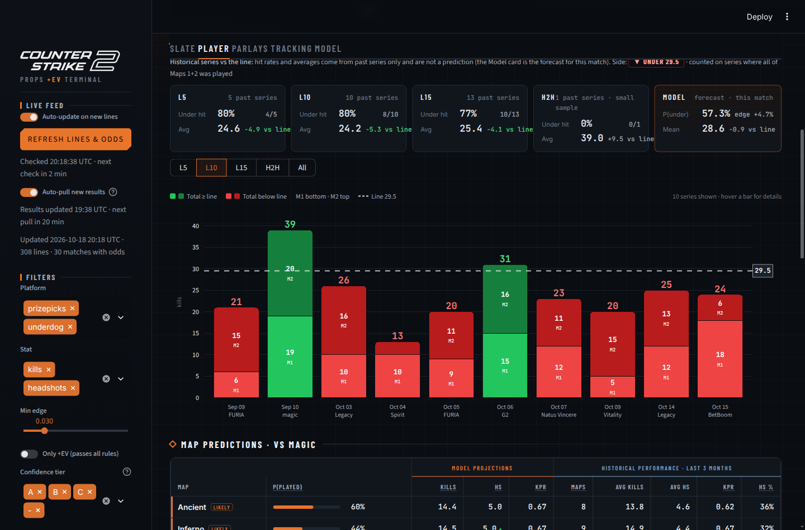

# CS2 Prop Intelligence

Predicts CS2 player **kills** and **headshots** (single maps and Maps 1+2), prices PrizePicks / Underdog pick'em lines against
the model, flags +EV picks and evaluates correlated slips. Ships as a Streamlit dashboard and an optional desktop window.

## Features
- Six months of bo3.gg map-level player history (tier S/A/B for training and pricing, tier C as extra player history), leak-free rolling features
- LightGBM + negative-binomial kill model, conditional beta-binomial headshot model, Platt calibration on a held-out window
- Exact analytic single-leg P(over/under); seeded, cached Monte Carlo for correlated multi-leg slips
- Live lines from PrizePicks and Underdog; match / map / rounds / overtime odds from Pinnacle's guest API, Polymarket and Thunderpick (via bo3.gg), used in that order
- Dashboard: +EV play cards with match start times (US Eastern), sortable full board, manual slip builder (Power / Flex
  multipliers), pick / result / CLV tracking, CSV / JSON export
- Player Panel: profile header that separates model edge from qualified picks, Recent Series stacked M1+M2 chart vs the line,
  L5 / L10 / L15 / H2H / All historical hit rates, Map Predictions (model vs history), per-map comparison, match history
  grouped by series, opponent breakdown, a line stepper that re-prices the chart, hit rates and model edge at a hypothetical
  (e.g. bumped) line, high-round / blowout map markers, and a match card with event, tier, LAN/online and the moneyline
- Broadcast-style player portraits: per-photo face framing (OpenCV) on a charcoal backdrop, default crop as fallback
- Auto-updates while open: lines and odds every 2 minutes, newly finished bo3.gg results every hour
- Windows and macOS desktop app (download from GitHub Releases)
- Chronological backtest with Brier, log loss, MAE, pinball loss and calibration tables

## Screenshots
| Dashboard | Full board |
|---|---|
|  |  |
| **Player Panel** | **Recent Series vs the line** |
|  |  |

## Architecture
```
cs2model/
  scraper/     bo3.gg history crawler, PrizePicks / Underdog lines, Pinnacle / Polymarket / Thunderpick odds, portrait framing
  features/    rolling player / team / map features (prior maps only)
  training/    model training, calibration, backtest
  inference/   predictor, analytic pricing (analytic.py), match simulation (simulate.py)
  parlay/      slip EV and optimizer
  tracking/    SQLite store for picks, results, ROI, CLV
  dashboard/   Streamlit app
  pipeline.py  end-to-end slate run;  cli.py  command line entry point;  desktop.py  desktop launcher
config/        settings.yaml (filters, Kelly, simulation), payouts.yaml (pick'em multipliers)
desktop/       PyInstaller build script;  tests/  unit tests;  .github/workflows/desktop.yml  Windows / macOS app builds
```
Generated data (`data/`: crawl cache, history, tracking DB) and trained models (`models/`) are not committed; rebuild them with the commands below.

## Environment variables
None are required: every data source used is public and unauthenticated. Configuration lives in `config/*.yaml`.
Never commit `.env` files or credentials; `.gitignore` excludes them.

## Development
```bash
pip install -r requirements.txt
python -m cs2model.cli crawl      # pull ~6 months of bo3.gg history into data/
python -m cs2model.cli train      # fit models into models/
streamlit run cs2model/dashboard/app.py   # dashboard on http://localhost:8501
python -m cs2model.desktop        # same dashboard in a desktop window
python -m pytest -q               # unit tests
ruff check cs2model tests --select E,F,W --ignore E501   # lint
```

## Original notes

This project predicts a full distribution of CS2 player **kills** and **headshots** (per map, Maps 1+2 and
Maps 1-3). It compares those predictions with live PrizePicks and Underdog lines and flags picks that are
+EV after the platform's payout. It also builds correlation-aware Power/Flex slips and logs picks and slips
so you can track ROI, CLV and calibration.

## Quick start (Mac / Linux)

```bash
python3 -m venv .venv && source .venv/bin/activate
pip install -r requirements.txt          # Mac: if LightGBM fails to import, run `brew install libomp`
python -m cs2model.cli crawl             # ~6 months of bo3.gg map stats -> data/player_maps.csv incl. per-map AWP kills (first run ~4-5 h, then cached)
python -m cs2model.cli train             # trains models, prints the backtest table
streamlit run cs2model/dashboard/app.py  # dashboard at http://localhost:8501
```

**Before you trust any EV number,** open `config/payouts.yaml` and enter the payouts your app shows today.
The multipliers in this file are used as-is (`verified: true`); edit them if your app shows different ones.

## Desktop app (Windows / macOS)

**Download:** grab `CS2Props-windows.zip` or `CS2Props-mac.zip` from the
[latest release](https://github.com/criscanales/cs2-prop-intelligence/releases/latest), unzip it and double-click
`CS2 Props.exe` (Windows) or `CS2 Props.app` (macOS).

`python -m cs2model.desktop` opens the dashboard in its own native window (pywebview). If no native webview is
available, it falls back to your browser.

To get a double-click app, build it on the target OS:

```bash
pip install -r requirements.txt pyinstaller==6.22.3 pywebview==5.3.2
python desktop/build.py        # Windows -> dist/CS2 Props/CS2 Props.exe, macOS -> dist/CS2 Props.app
```

Or run the `desktop-build` workflow (Actions tab), which also runs on every `v*` tag. It builds both and uploads zips.

The packaged app keeps its data, models and editable config in `~/CS2Props` (Windows: `C:\Users\<you>\CS2Props`).
On first launch it offers **Quick start: download and train**. It downloads the most recent 45 days of bo3.gg map stats
(`quickstart_days` in `config/settings.yaml`; about 1.5-2 hours, with a progress bar showing the day and row count), trains,
and opens the dashboard. The app is labeled **Partial history** while the rest of the 6-month window (about 4 more hours)
downloads in the background at the same request rate; the sidebar shows backfill progress. When it finishes, a full-history
model is trained and replaces the quick-start model only if it scores at least as well on the same held-out maps.
Keep the app open and the computer awake. If it is interrupted, open the app and click the button again: every response
already downloaded is cached, so it resumes quickly.

**Moving to another computer:** Model tab → **History and data bundle** → Export writes a local zip (`exports/`) with your map history,
AWP data and models, plus a checksummed manifest. It never includes your tracking log, settings, HTTP cache, API keys,
cookies or tokens. On the other computer, use **Import a data bundle** on the setup screen (or in the Model tab). Records already
on disk are not duplicated, and your existing models are kept unless you tick "Replace my models". After importing, the app
only downloads maps that are missing or newer. The bundle is for your own machines; don't share it publicly, since it
contains bo3.gg data.

Unsigned builds:
- **macOS:** open the app once and click Done on the "not opened" warning, then go to System Settings → Privacy & Security
  and click **Open Anyway** next to CS2 Props. Or run `xattr -dr com.apple.quarantine "/path/to/CS2 Props.app"` once.
- **Windows:** in the SmartScreen prompt, choose More info, then Run anyway.

Other commands:

| command | what it does |
|---|---|
| `python -m cs2model.cli slate [--log-picks]` | prices current lines, prints +EV picks and the best slip per play type, exports CSV/JSON to `data/out/` |
| `python -m cs2model.cli grade` | grades logged picks and slips against bo3.gg results and prints ROI/CLV |
| `python -m cs2model.cli refresh --every 30 [--retrain]` | crawls new days, grades, optionally retrains, then re-prices; loops every N minutes |
| `pytest -q` | unit tests |

To schedule runs, add a cron entry such as `*/30 * * * * cd /path/cs2-props && .venv/bin/python -m cs2model.cli refresh`.
Or leave `refresh --every 30` running in a terminal.

While the dashboard is open it also does this itself: with **Auto-pull new results** on (sidebar), it pulls newly finished bo3.gg matches every `results_refresh_min` minutes (default 60), grades logged picks and re-prices the slate in the background. Retraining still needs the CLI.

## Data sources

All requests use plain `requests` with a descriptive User-Agent. The client throttles each host (≥0.6 s between
calls plus jitter) and retries 429/5xx with exponential backoff. Responses are cached under `data/cache/`;
finished matches are cached forever, so re-crawls only fetch new days. A 401/403 raises `AccessDenied`, and that
source is skipped and reported in the CLI and dashboard instead of being worked around.

| source | used for | how |
|---|---|---|
| **bo3.gg** public JSON API (primary stats) | per-player per-map kills, HS, ADR, KAST, rating, opening duels; map, score, rounds; tier, LAN/online, BO format | `/api/v2/matches/finished?date=`, `/api/v1/games?filter[games.match_id][eq]=`, `/api/v1/games/{id}/players_stats`, `/api/v1/tournaments?filter[tournaments.id][eq]=` |
| **PrizePicks** | CS2 kills/HS lines | `partner-api.prizepicks.com/projections?league_id=265` (demon / goblin handling: see +EV rules) |
| **Underdog** | CS2 kills/HS lines + per-line prices | `api.underdogfantasy.com/v1/over_under_lines` |
| **Pinnacle** guest API | series/map moneylines, map round-total ladders, map overtime yes/no | `guest.api.arcadia.pinnacle.com/0.1/sports/12/...`, the same public endpoints pinnacle.com calls when logged out |
| **Polymarket** public API | series/map moneylines, map-3 yes/no, map round totals (mid price; skipped when the spread is wide) | `gamma-api.polymarket.com/events?tag_slug=counter-strike-2`, no key; backtested in `docs/validation.md` |
| **Thunderpick** (via bo3.gg) | match moneylines | Pre-match Thunderpick odds that bo3.gg publishes in its upcoming-matches feed (`bet_updates`) |

If a source fails, 429/5xx/timeouts get a few jittered, capped retries, and Retry-After is honored. After two failed pulls
in a row Pinnacle is paused for 5 minutes, doubling up to 30. A 401/403 is reported as access denied and not retried.
The last good Pinnacle pull is kept in `data/pinnacle_last_good.json` and shown as stale with its original time.
It is never used for pricing: matches fall back to the next live source, or to the labeled model Elo.

**Match card series probability (Player panel, information only).** The card shows a series win % only from a
Pinnacle / Thunderpick / Polymarket snapshot taken before the listed start; otherwise it says "Pre-match odds unavailable"
(model Elo is never shown there). It never feeds projections, edges, confidence or picks.
- **Series moneyline:** the book quoted a series price. Two-way prices are de-vigged multiplicatively
  (each 1/decimal price divided by their sum); Polymarket uses the bid/ask mid and is skipped when the spread is wide.
  Under each % the card shows **Fair odds (no-vig)**, the American odds of that probability, which is not a bettable
  price. When the book's own pre-match series price was captured (Pinnacle, Thunderpick) it is shown separately as
  **Book odds**, the quoted price including vig, from the same snapshot (source and time in the footer). Polymarket
  is an exchange read at the mid price, so it has no Book odds. Fair odds are never shown as Book odds.
- **Estimated series probability · derived from map odds:** the book quoted only map winners. Each map price is
  de-vigged the same way, then `series_win` combines them assuming maps are independent:
  BO3 = p1·p2 + (p1·(1−p2) + (1−p1)·p2)·p3; BO1 = p1; BO5 uses map 1's price for every map (binomial).
  A map with no price uses map 1's price. This ignores map-pick/veto order and momentum between maps, so it is an
  estimate, shown without American odds, and never presented as a quoted series price.

**Not used:**
- **HLTV.** Plain HTTP gets a Cloudflare 403 challenge. Getting past it would mean bypassing access controls, so HLTV is skipped.
- **thunderpick.io directly.** It also answers 403 to non-browser clients. Its odds come through bo3.gg instead.

Window: `history_days: 183` in `config/settings.yaml` (last ~6 months). Tiers S/A/B/C are crawled
(`history_tiers`), so a player's maps on earlier or lower-tier teams count toward his form, but only tier-1/2
events (S/A/B, `tiers`) are trained on and priced. Lines are priced only when both teams have at least
`min_team_maps` tier-1/2 maps in the last `team_maps_days` (92), which skips one-off and unranked teams.
See `docs/validation.md` for the 3- vs 6-month backtest.

AWP share: bo3.gg's per-map weapon stats (`/games/{id}/weapons_stats`) give each player's AWP kills. The share of his
kills with the AWP over his last 20 maps is a model feature (`awp_share`, it lowered headshot error on AWPers,
hybrids and short histories in the backtest) and shows in the Player Panel as AWPer (30%+) / Hybrid (10-30%) /
Rifler, with no role until 5 maps have weapon data.

## Model

1. **Features** (`cs2model/features/build.py`). Every feature for a map uses only maps that finished before it. Unit tests check this.
   - **Player form:** last 5/10/20 maps and recency-weighted EWM for KPR, HS%, rating, ADR, KAST, opening-duel rate and opening-duel win share (an entry/role proxy). Also shrunk KPR/HS%, kill SD, map-specific KPR, rest days, maps in the last 7 days and rounds played.
   - **Team and opponent:** pre-map Elo (team, opponent, difference, win probability), team pace (rounds per map), overtime rate, opponent kills allowed per round (overall and on this map), map win rates and newcomers in the lineup.
   - **Context:** BO1/3/5, LAN or online, tournament tier, map number, map.
   - **Roster:** `tenure` (maps with the current team). Fewer than 3 maps means a stand-in or new signing, and the pick is excluded. `role_shift` is the change in last-5 vs last-20 opening-duel share; large shifts are flagged.
2. **Main model.** Two LightGBM Poisson models:
   - kills, with a log(rounds) offset, which gives **kills per round**
   - headshots, with a log(kills) offset, which gives **HS per kill**
3. **Predictive distribution** (`inference/distribution.py`, `inference/simulate.py`), built per map:
   - Rounds come from the empirical distribution for that matchup closeness. They are tilted to Pinnacle's round-total ladder and overtime price when available.
   - The map winner is drawn from the market (or Elo). Winners get a kill-rate multiplier fit on validation data, normalised so the expected value is unchanged.
   - Kills follow a NegBin with dispersion fit on validation data. HS | kills follow a Beta-Binomial.
   - Map picks are drawn from both teams' recent map pools. Map 3 is played only when maps 1–2 split.
   - **Map pool model** (`cs2model/maps/pool.py`): map picks come from a Plackett-Luce model on each team's decayed
     play share and map record (bo3.gg), which beat the old play-frequency blend on held-out series. A per-map win
     model (map strength vs Elo) is also fit, but it is only used for pricing when it beats one win chance on every map
     out of sample; currently it doesn't, so it's off. Both results are on the Model tab.
   - **Shrink toward recent form:** the raw LightGBM rate is pulled part of the way back to the player's shrunk
     last-20-map rate (fit on validation: about 12% for kills, 44% for HS), because it over-extended when it moved far
     from a player's average.
   - Rolling-window validation of both (by period, tier, format and sample size): [`docs/validation.md`](docs/validation.md).
   - A 50k-draw joint simulation per match produces P(over/under) for any line, plus quantiles.
4. **Calibration.** Platt scaling on logit(P) fit on the validation split, separately for kills/HS and single-map/multi-map.
5. **Baselines.** A negative-binomial GLM (statsmodels, same offset) and a naive last-10 average with a Poisson distribution.
6. **Validation.** Time-ordered 70/15/15 split by map date, no shuffling. Metrics: MAE, pinball loss (q10/50/90), Brier, log loss, calibration table, hit rate, flat-stake ROI, and edge buckets.
   - Historical prop lines aren't archived publicly, so backtest "lines" are the naive mean rounded to .5. Backtest ROI is therefore only indicative. Real performance comes from the tracker.

## +EV rules (`config/settings.yaml`)

- **Edge** = model P(side) − breakeven. The breakeven comes from the platform's `single_pick_reference` play in `payouts.yaml`, e.g. 2-Power = 3^(-1/2) ≈ 57.7%, or 1/decimal for Underdog lines that carry their own price.
- **Thresholds:** min edge 3%, min 15 prior maps.
- **PrizePicks demon / goblin lines** (over only; `alt_lines` in `payouts.yaml`). The API doesn't publish their payouts.
- **Lower-tier demons** (sidebar toggle / `demon_lower_tier`): demons are also priced when each team has at least
  `demon_min_team_maps` tier-1/2 maps (default 4) instead of `min_team_maps`. They're capped at confidence C.
  - Demons are priced at the standard breakeven. Demons pay more than standard, so their edge is a lower bound. Cards show a **Demon** badge.
  - Goblins pay less than standard, so they stay excluded until you enter a per-pick decimal payout for them.
  - Underdog lines with their own price (alt payouts) already use 1/decimal as the breakeven.
- **Excluded or flagged:**
  - stand-ins
  - recent role changes
  - model mean more than 35% away from the line (likely news)
  - lines that moved ≥1.5 since first seen (tracked in `data/tracking.db`)
- **Confidence tiers:**
  - **A:** ≥30 maps, ≥10 maps with the team, edge ≥6%, priced with market odds
  - **B:** ≥20 maps and edge ≥4%
  - **C:** other picks that pass
- Each pick gets a one-line reason (form, opponent, map win %, overtime %, map 3 %).

## Slips (`cs2model/parlay/engine.py`)

- **Play types** come from `config/payouts.yaml`: 2-Power, 3-Power/Flex, 5-Power/Flex, 6-Power/Flex, plus an optional 2-Flex. 4-leg plays are excluded.
- **Hit matrix.** All legs are drawn from the same match simulations. Same-match legs share map picks, pace, overtime and winner; the same player's kills and HS share draws. The draws are then thinned to the calibrated marginal probabilities.
- **EV.** Power uses P(all hit). Flex uses the exact distribution of hit counts. EV under independence and `corr_ratio` (P(all) ÷ product of leg probabilities) are reported. Heavily correlated slips are penalised and flagged. Max 2 legs per match by default, so slips favour different matches.
- **6-leg sanity check.** A +EV 6-leg slip must stay +EV when legs are treated as independent and every leg is made 2pp worse.
- **Example slips (sidebar).** Opens a window with up to 3 hypothetical slips from the optimizer for PrizePicks or Underdog, with a copy button per slip and a link to the platform's own pick'em page. Nothing is placed or prefilled. Legs in the same match share simulations (dependence modeled); different matches are treated as independent. EV is optimistic: it is the best of many combinations and slip results aren't validated on graded slips yet.
- **Stake.** Full Kelly is solved over the hit distribution, then multiplied by `kelly_fraction` (0.25). Each slip is capped at `max_stake_pct`, and the best slip per play type is scaled to `daily_exposure_pct`.

## Tracking

Every priced standard line is logged (`preds` table) with its last pre-match projection and graded when results arrive;
the Model tab's "Does the model run high?" section shows model minus actual on these real lines. While open, the app also
retrains the models in the background once they are `retrain_days` (7) old, right after an hourly results pull.

Each pick and slip you log is stored in `data/tracking.db`, along with line snapshots. `grade` fills in actual
results, closing lines (CLV) and slip payouts. The dashboard's Tracking tab shows hit rate, flat ROI, CLV, slip
profit and live calibration.

## Limitations

- Three months of data is enough for form but thin for map-specific splits, which are shrunk toward overall form.
- Veto prediction is approximate: maps are drawn by both teams' recent play frequency, not modelled from pick/ban order.
- bo3.gg has no AWPer/role tags in the per-map stats feed. Role is approximated by opening-duel involvement.
- PrizePicks/Underdog promos, boosted lines and state-specific payouts are not modelled. Keep `payouts.yaml` current.
- Not betting advice. Check local laws and platform terms.
